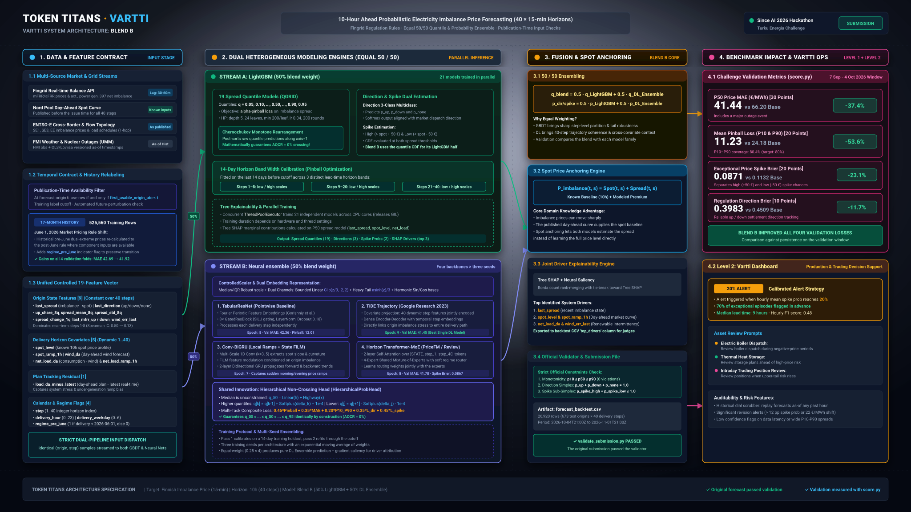

# Vartti: Finnish imbalance price forecasting

Built by Team Token Titans for the [Since AI 2026](https://sinceai.ai/hackathon) Turku Energia challenge. Vartti forecasts the next ten hours in 15-minute steps: the median imbalance price, an 80% prediction interval, regulation direction probabilities, and the chance of an exceptional price.

## Try the dashboard

Run from the repository root:

```sh
python -m http.server 8000 -d research/imbalance-forecast/frontend
```

Open [http://localhost:8000](http://localhost:8000). Move the issue time back to inspect a forecast as it would have appeared at that hour. The dashboard shows intervals, alerts, forecast revisions and past performance on simulated data. The browser loads ECharts and fonts from public CDNs.

## How it works

- **Feature availability:** every input is filtered by its publication time at the forecast origin. Training labels have their own publication cutoff. The [leakage check](research/imbalance-forecast/submission/leakage_check.py) perturbs unavailable values to check that they cannot change features.
- **Forecasting:** [LightGBM](research/imbalance-forecast/submission/make_submission.py) estimates a quantile distribution for the imbalance price spread over spot. The [neural ensemble](research/imbalance-forecast/dl/models.py) combines TabularResNet, TiDE, Conv-BiGRU and Transformer-MoE. The submission blends both model families with equal weights.
- **Research:** The [TiDE research implementation](experiments/imbalance_dl/tide/) uses a shared forecast interface; the [probabilistic modules](research/imbalance-forecast/probability/) explore spline quantiles, calibration and adaptive aggregation.

On the challenge validation window, the team's Blend B scored **41.44 €/MWh MAE** versus **66.20 €/MWh** for persistence. Mean P10/P90 pinball loss fell from **24.18** to **11.23**. See the [evaluation summary](docs/evaluation.md) for the other metrics and the distinction between validation and local test scores.

[Explore the five architecture diagrams](docs/architecture/README.md) for Blend B and its four neural backbones.

[](docs/architecture/blend_b_architecture.svg)

## Explore the model code

With Python 3.12:

```sh
python -m pip install -r requirements-demo.txt
python -m experiments.imbalance_dl smoke
```

The smoke command runs CPU forward passes and computes losses on generated tensors. This public edition contains selected source code and a synthetic demo. Exact competition reproduction requires separately authorised inputs, the original tooling and a fresh model fit. See [where to obtain data](data/README.md) and [third-party notices](docs/third-party.md).
